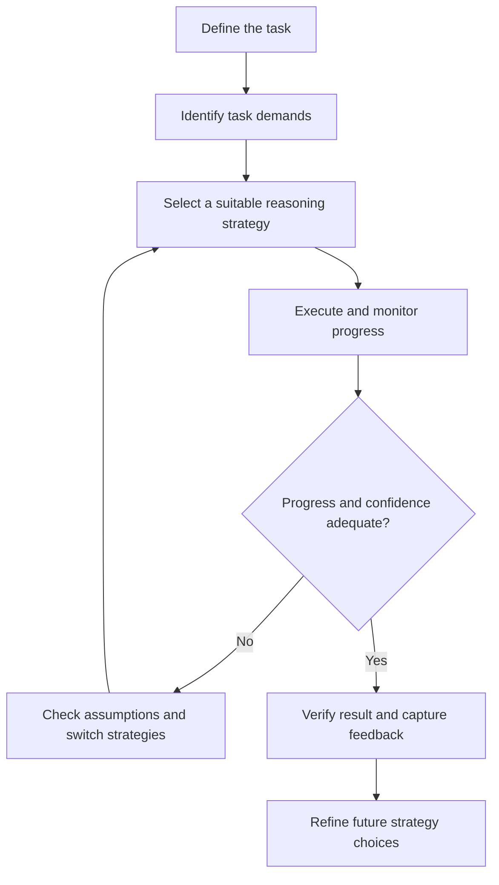

# Proposed cognitive strategy-routing framework

This is a conceptual analogy and design hypothesis, **not** a validated neuroscience model.

## Candidate strategies

| Strategy | Potential use | Possible cost |
| --- | --- | --- |
| Decomposition | Complex multi-step problems | Can lose interactions between parts |
| Assumption listing | Ambiguous problems | Time overhead |
| Counterexample search | Testing a favoured explanation | Unproductive over-scepticism |
| Alternative hypotheses | Causal reasoning | Too many weak explanations |
| Confidence calibration | Uncertain predictions | Miscalibrated estimates |
| External notes and diagrams | Working-memory-heavy tasks | Can become cumbersome |
| Retrieval practice | Durable learning | Depends on prior knowledge |
| Verification and stopping rules | Time-constrained decisions | Can stop too early |

## Hypothesised mechanisms

Better recognition of task demands; improved strategy selection and switching; stronger error detection and calibration; more effective external aids; and better learning from feedback.

## Competing explanations

Task familiarity, motivation, domain knowledge, additional time, teacher attention, selection effects, and measurement artefacts can all mimic improvements.

## Boundary conditions

Not every strategy works for every task. Cognitive capacity, education, environment, health, and domain knowledge still matter. Improvement on practised exercises must not be assumed to generalise.
